# ⚡ Awesome Continuous Integration & Delivery Integrations

### 🚀 Top CI/CD Pipelines, Build Automation, GitOps Engines & Deployment Tools Ecosystem

  
  
  
  
  
  
  

**A comprehensive, SEO-optimized curated directory of top-tier SaaS platforms, cloud runners, and open-source self-hosted CI/CD frameworks.**  
*Empowering DevOps engineers, Site Reliability Engineers (SREs), and platform architects with automated build, test, and release toolchains.*

**📅 Last updated: March 2026**

---

## 📖 Table of Contents
- [📌 Overview & Architecture](#-overview--architecture)
- [📊 Sector Overview & Market Dynamics](#-sector-overview--market-dynamics)
- [☁️ SaaS & Hosted CI/CD Platforms](#️-saas--hosted-cicd-platforms)
- [🐙 Open-Source GitHub Projects](#-open-source-github-projects)
- [🤝 How to Contribute](#-how-to-contribute)
- [💖 Support & Community](#-support--community)
- [⭐ Star History](#-star-history)
- [⚖️ Disclaimer](#️-disclaimer)

---

## 📌 Overview & Architecture

**Continuous Integration and Continuous Delivery (CI/CD)** forms the backbone of modern cloud engineering, DevOps practices, and agile software development life cycles (SDLC). CI/CD integration tools automate the entire code transit route:
- 📥 **Source Control Triggers**: Listening for Git push, pull request, merge, and tag events.
- ⚙️ **Automated Build & Compile**: Orchestrating multi-architecture compilation and container image builds.
- 🧪 **Automated Testing & Quality Gates**: Parallel unit testing, integration tests, static code analysis (SAST), dynamic security tests (DAST), and code coverage metrics.
- 🚀 **Progressive Delivery & GitOps**: Blue-green deployments, canary rollouts, container orchestration, and continuous configuration synchronization across hybrid clouds and Kubernetes.

Whether you are seeking zero-maintenance managed SaaS runners or enterprise-grade open-source workflow engines without unpredictable cloud compute charges, this directory categorizes the industry leaders.

---

## 📊 Sector Overview & Market Dynamics

The global Continuous Integration & Delivery (CI/CD) and automated deployment pipeline market is valued between **$4 billion and $13 billion**, expanding rapidly at a CAGR of 15–20% fueled by cloud-native adoption and DevSecOps consolidation. The sector exhibits a distinct two-tier market structure: it is **moderately concentrated at the enterprise layer** where hyperscalers and SCM-integrated powerhouses (Microsoft/GitHub, GitLab, Atlassian) capture dominant market share through unified developer platforms, yet **highly fragmented across the broader ecosystem** with specialized niche tools, GitOps controllers, and self-hosted open-source runners tailored for custom and air-gapped infrastructure.

---

## ☁️ SaaS & Hosted CI/CD Platforms

| Product | 🏢 Company Scale (Valuation / Revenue) | 📝 Description | 💳 Pricing (Starting) | 🎁 Free Tier / Trial Limits |
|---------|------------------------------------|-------------|-------------------|--------------------------|
| **[Azure Pipelines](https://azure.microsoft.com/en-us/products/devops/pipelines/)** | **~$3.1 Trillion** market cap (Microsoft) / **$245B+** annual revenue | Microsoft's enterprise CI/CD service with YAML pipelines. GitHub-hosted agents available with pay-as-you-go pricing (macOS Standard $0.062/min, Linux 8-core $0.022/min, Windows 8-core $0.042/min). | **Free plan**: 1 Microsoft-hosted job with 1,800 minutes/month + 1 self-hosted job with unlimited minutes; public open-source projects receive 10 free parallel jobs. |
| **[GitHub Actions](https://github.com/features/actions)** | **~$100 Billion+** valuation (Microsoft subsidiary) / **$1B+** ARR | Native CI/CD embedded in GitHub with 20,000+ Marketplace actions. Self-hosted runner usage carries a $0.002/minute platform charge (drawn from free quota). | **Free plan**: 2,000 minutes/month for private repositories; **public repositories have 100% free unlimited minutes** (up to 20 concurrent jobs). |
| **[Bitbucket Pipelines](https://bitbucket.org/product/features/pipelines)** | **~$50 Billion** market cap (Atlassian) / **$4.4B+** annual revenue | Integrated CI/CD built directly into Atlassian Bitbucket with tight Jira and Confluence integrations. | Standard: **$3/user/month**; Premium: **$6/user/month** (annual billing). | **Free plan**: 5 users, 50 build minutes/month per workspace, and up to **100 free basic self-hosted runners** included. |
| **[GitLab CI/CD](https://about.gitlab.com/)** | **~$8.5 Billion** market cap (NASDAQ: GTLB) / **$750M+** ARR | Integrated DevSecOps platform with `.gitlab-ci.yml` pipelines, Auto DevOps, and native Kubernetes cluster integrations. | Premium: **$29/user/month** (annual commitment); Ultimate: **$99/user/month**. | **Free plan**: 400 compute minutes/month per namespace, up to 5 user seats, and **unlimited self-hosted runners** (0 minutes charged). |
| **[CircleCI](https://circleci.com/)** | **$1.7 Billion** valuation (Series F) / **~$60M** ARR | Cloud-native CI/CD featuring reusable Orbs, Docker layer caching, automated test splitting, and dynamic config generation. | Performance: **$15/month** base (includes 30,000 credits; additional credits at $15 per 25,000 credits). | **Free plan**: 30,000 build credits/month (~3,000 Linux build minutes), 5 active users, 5 self-hosted runners, and 1 macOS concurrent job (credits expire monthly). |
| **[Travis CI](https://www.travis-ci.com/)** | **~$1.1 Billion** parent valuation (Idera, Inc.) / **~$200M+** parent revenue | Pioneer cloud CI platform utilizing `.travis.yml` configs for multi-language testing matrix workflows. | Usage Based: **$13.75/month** (includes 420,000 Linux build credits/year and 80 concurrent jobs); Unlimited: **$66/month**. | **Free trial**: 10,000 one-time trial build credits (approx. 1,000 Linux build minutes) valid for up to **14 days** (or until credits exhaust). |
| **[TeamCity](https://www.jetbrains.com/teamcity/)** | **~$650 Million+** annual revenue / Bootstrapped multi-billion private tier (JetBrains) | JetBrains' continuous integration and build management engine with intelligent test execution and build history analysis. | Cloud: **$15/committer/month** (minimum 3 committers = $45/month, includes 24,000 build credits); On-premises Enterprise: **$2,399/year**. | **Professional (On-Premises)**: **Free forever** with 3 build agents, 100 build configurations, and unlimited users; **Cloud**: **14-day free trial** with full agent access. |
| **[Codefresh](https://codefresh.io/)** | **~$50 Million** acquisition price (acquired by Octopus Deploy) / **~$85M** combined ARR | Kubernetes-native CI/CD and GitOps platform natively integrated with Argo CD and enterprise cluster workflows. | Starter SaaS: **$99/month**; Enterprise GitOps contracts start around **$1,250/month** ($15,000/year). | **Free plan**: 1 concurrent build, up to 500 build minutes/month, and community GitOps integration; **14-day free trial** for enterprise tiers. |

---

## 🐙 Open-Source GitHub Projects

*Ranked in descending order of community GitHub star counts.*

| 📦 Project | 🌟 Star Badge | 📝 Description |
|------------|---------------|----------------|
| **[nektos/act](https://github.com/nektos/act)** |  | Run GitHub Actions locally inside Docker containers. Enables rapid local testing and iterative development of CI workflows without pushing commits. |
| **[Jenkins](https://github.com/jenkinsci/jenkins)** |  | The industry-standard open-source automation server (MIT). Features 1,800+ community plugins supporting every language, cloud provider, and build toolchain. |
| **[Argo CD](https://github.com/argoproj/argo-cd)** |  | Declarative, GitOps continuous delivery tool for Kubernetes (CNCF graduated). Automatically synchronizes live application states with Git repository declarations. |
| **[Argo Workflows](https://github.com/argoproj/argo-workflows)** |  | Container-native workflow engine orchestrating parallel jobs on Kubernetes (CNCF graduated). Define DAGs or sequential steps with artifact management and cron scheduling. |
| **[Spinnaker](https://github.com/spinnaker/spinnaker)** |  | Multi-cloud continuous delivery platform originally developed by Netflix for enterprise automated releases across AWS, GCP, Azure, and Kubernetes with automated canary analysis. |
| **[Tekton Pipelines](https://github.com/tektoncd/pipeline)** |  | Cloud-native, Kubernetes-standard CI/CD building blocks (CDF graduated). Provides CRDs for defining modular, portable, and reusable multi-stage pipeline workflows. |
| **[Flux CD](https://github.com/fluxcd/flux2)** |  | Set of continuous and progressive delivery controllers for Kubernetes (CNCF graduated). Powers open and extensible GitOps pipelines. |
| **[Woodpecker CI](https://github.com/woodpecker-ci/woodpecker)** |  | Lightweight, community-driven, container-based continuous integration engine (fork of Drone 0.8) running pipelines in isolated containers with simple YAML specs. |
| **[Concourse CI](https://github.com/concourse/concourse)** |  | Open-source continuous thing-doer built on simple mechanics: tasks, resources, and jobs. Purely declarative, stateless, and containerized pipeline automation. |
| **[Danger](https://github.com/danger/danger)** |  | Connects with CI systems and pull request review workflows to automate PR checks, enforce team norms, and post lint/security findings directly in code review threads. |
| **[CDS](https://github.com/ovh/cds)** |  | Enterprise-grade continuous delivery and DevOps automation platform written in Go by OVHcloud. Features complex pipeline DAGs, built-in artifact storage, and self-hosted worker clustering. |
| **[PHP Censor](https://github.com/php-censor/php-censor)** |  | Open-source self-hosted continuous integration server specifically tailored for PHP development teams and automated test suites. |

---

## 🤝 How to Contribute

Contributions are welcome! Please help keep this curated list up-to-date and accurate:

1. 🍴 **Fork the Repository** on GitHub.
2. 🌿 **Create a Feature Branch** (`git checkout -b feature/add-new-tool`).
3. 📝 **Add/Update Entries** following the established table schema (include tool name, website/repo link, verified starting pricing, and concrete free tier limits).
4. 📬 **Submit a Pull Request** with a descriptive summary of your changes.

---

## 💖 Support & Community

Thank you for exploring and utilizing this curated CI/CD integrations guide! If you find this directory valuable for your engineering workflows, please consider supporting the project:

- ⭐ **Star this repository** to improve discoverability for fellow DevOps engineers.
- 🍴 **Fork and share** with your development and platform engineering teams.
- ☕ **Sponsor or buy a coffee**: Show your appreciation and support continuous maintenance via the [GitHub Sponsor Dashboard](https://github.com/sponsors/ishandutta2007).

---

## ⭐ Star History

---

## ⚖️ Disclaimer

- This is a **community-curated** list — not an official vendor endorsement.
- Continuous Integration & Delivery platforms manage production access, secrets, and deployment pipelines. Always follow the principle of least privilege (PoLP), mask environment variables, audit third-party runner actions, and isolate self-hosted runner infrastructure.
- Vendor pricing structures and quotas evolve over time. Always verify current commercial pricing with respective official vendor portals before enterprise adoption.
